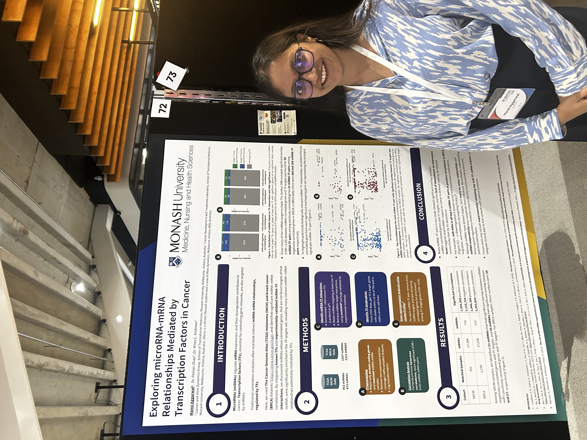

# mirna-tf-mrna-cancer

[**Transcription factors mediate microRNA-gene relationships in cancer**](https://mansi-agg.github.io/mirna-tf-mrna-cancer/)

MicroRNAs (miRNAs) regulate gene expression by binding to messenger RNAs (mRNAs), and the usual way to find miRNA targets is to look for miRNA–mRNA expression correlations. But miRNAs also target transcription factors (TFs), so many of those correlations may be *indirect*: the miRNA regulates a TF, and the TF regulates the gene.

This project tests that idea using matched mRNA and miRNA sequencing data from The Cancer Genome Atlas (TCGA). For each miRNA it:

1. finds the genes whose expression correlates significantly with the miRNA (Spearman, BH-adjusted *p* < 0.05);
2. finds TFs the miRNA is experimentally validated to target ([multiMiR](https://doi.org/10.1093/nar/gku631), [Human TFs](http://humantfs.ccbr.utoronto.ca));
3. finds each TF's target genes from cancer cell-line ChIP-seq ([ChIP-Atlas](https://chip-atlas.org));
4. removes the miRNA's own direct targets and uses over-representation analysis ([clusterProfiler](https://doi.org/10.1016/j.xinn.2021.100141)) to test whether the remaining correlated genes are enriched for that TF's targets.

Significant miRNA–TF pairs point to candidate miRNA → TF → mRNA regulatory relationships. 

The full manuscript can be read [here](https://mansi-agg.github.io/mirna-tf-mrna-cancer/).

## History

This started as my Master's thesis at Monash University (submitted in June 2024) with [Dr. Miles C. Andrews](https://www.monash.edu/medicine/translational/cancer-medicine/research/andrews-group) as my supervisor and [Dr. Peinan Zhao](https://scholar.google.com/citations?user=3t8PeMwAAAAJ&hl=en) as my co-supervisor. As a part of the thesis, we analysed melanoma only (**TCGA-SKCM**). We then extended the analysis to breast cancer (**TCGA-BRCA**) to test whether these indirect, TF-mediated miRNA–mRNA relationships generalise beyond melanoma.

We developed an approach for inferring indirect, TF-mediated relationships between miRNAs and genes, and identified candidate miRNA–TF–gene triplets that warrant experimental validation. 


## Running the analysis

Open `R/main.R`, choose the cancer and which steps to rerun, and source it:

```r
CANCER <- "BRCA"   # "BRCA" or "SKCM"

RUN_DOWNLOAD_TCGA         <- FALSE  # 1. download TCGA RNA / miRNA data (several GB)
RUN_EXPRESSION            <- FALSE  # 2. filter and log-transform expression data
RUN_CORRELATION           <- FALSE  # 3. mRNA-miRNA correlation
...
MAKE_PLOTS                <- TRUE   # 9. make and save the figures
```

A step set to `FALSE` reads its saved output from `data_files/TCGA-<CANCER>/`; `TRUE` reruns it and overwrites that output. If you rerun a step, also rerun the steps after it. All file names and parameters are in `R/config.R`, and each step calls a plain function from the other scripts in `R/`.

**Data:** the raw TCGA files (`*.RDS`), filtered expression matrices, correlation tables and ChIP-Atlas TF target files are large and not tracked in git. Set the `RUN_` options to `TRUE` to download and regenerate them.


## Poster

I presented this work as a poster at the [ABACBS 2025 conference](https://static1.squarespace.com/static/5423875be4b03f0c482a58c4/t/692282310b37fa4406e88c30/1763869233702/ABACBS+FINAL+program.pdf) in Adelaide. The full-resolution poster is available as a [PDF](poster/ABACBS_Poster.pdf).


